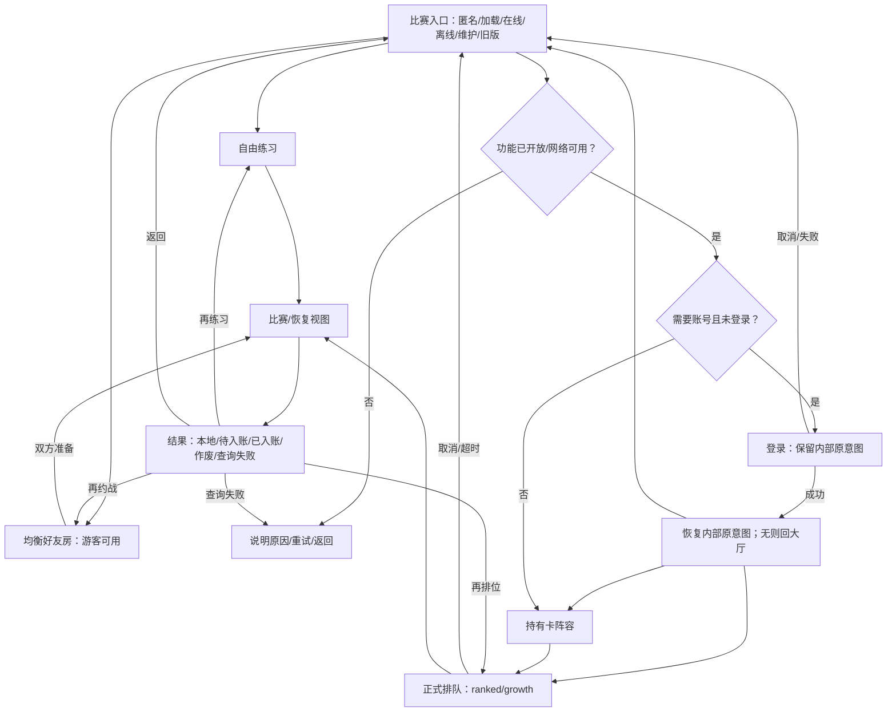

# 页面流、导航与视图模型

UI-01 的产物是页面契约和交互线框。当前可玩 Demo 入口保留；React 页面壳、真实账号、云资产和可靠结算分别由 UI-02/ACC/DAT/NET 接入，不把原型跳转算作这些业务已完成。

`packages/client-model` 是无 DOM/Canvas/存储依赖的共享边界。NavigationTargetSchema 只接受封闭的内部页面对象，拒绝额外字段和任意外链；登录回跳存同一份内部意图，不接收 URL。resolveNavigation 只决定页面准入，所有身份、持有权、资产和结算仍由服务端裁定。

游客 friend 保留 BAL-06 已确认的统一 Lv5、无正式奖励/积分规则。05-client-design 的一般“联机需登录”描述在该模式使用此明确例外；正式 ranked/growth、持有卡和云功能必须有账号。临时座位凭证不作为账号登录，不进入分享 URL。

五主入口：比赛、阵容、成长、俱乐部、我的。桌面左侧导航/中央比赛/右侧摘要；小屏顶部账号、中央内容、底部五入口。辅助消息含邮件/任务/成就，不新增充值主入口。settings 属于我的；页面 ID 跨端相同，Web 路径不强加给微信场景栈。

| 页面 / 路径 | 返回和异常状态 | 数据/API 边界与当前状态 |
|---|---|---|
| lobby `/` | 匿名/加载/离线/维护/旧版/错误 | `/me`、余额、公告：待 ACC/DAT/UI-03；未知余额用 loading，不填 0 |
| login `/login` | 成功回原意图；取消回比赛；提交/失败/离线 | register/login 请求 schema 已有；默认服务未挂账号路由，待 ACC；不伪造会话 |
| lineup `/lineup` | 返回比赛；加载/空卡/冲突/不足/错误 | ownedCardId、revision；GET/PUT `/me/lineups`、升级/craft schema，待 DAT/UI-04；不提交 playerDefId 代替 ownedCardId |
| growth `/growth` | 返回比赛；空/禁用/错误 | 成长内容待 LIV/DAT；初始开关关闭 |
| club `/club` | 返回比赛；无公会/满员/权限/错误 | 待 LIV-05；关闭时明确说明 |
| profile `/profile` | 允许游客；返回比赛；加载/错误 | 游客可看本地设置；云资料/设备会话待 ACC/UI-03 |
| settings `/settings` | 返回我的；离线本地设置/保存失败 | 音量/画质本地；安全会话交给平台服务，不能用普通偏好存储代替凭据仓 |
| inbox `/inbox/:section` | 返回比赛；空/过期/领取中/错误 | mail/tasks/achievements；领取需服务端幂等，待 LIV |
| queue `/queue/:mode` | 取消/超时回比赛；匹配成功去比赛 | 只 ranked/growth；票据/队列 schema 已有，实际匹配待 NET/MM |
| room `/room/:code?` | 对手离开/准备冲突/不兼容/返回 | 6 位邀请码；旧游客 SDK 好友房已实现；新壳接入待 UI-05/NET |
| match `/match/:matchId?` | 返回需确认；我方/对方/pending/回放/恢复/结束 | 在线比赛必须已有 matchId；practice 可新建；由 Canvas Host 裁定输入资格，页面不能自认胜负 |
| result `/result/:matchId` | 再来或回比赛；本地/待入账/已入账/作废/错误 | 只有服务端可靠结果和账本才显示正式金额；网络错误不等于奖励 0；待 UI-06/NET-04 |

当前默认服务器仅挂 catalog、健康和游客对战模块；HTTP_CONTRACTS 存在请求 schema 不代表账号/资产服务已可用。上表带“待”的操作必须保留功能关闭状态。DEFAULT_FEATURES 仅开启本地练习；ALL_FEATURES 只给测试与线框条件，不由生产启动默认采用。

准入顺序为：解析内部意图 → 功能开关 → 新远程操作的维护/版本/网络 → 账号读取/登录。维护或离线时不诱导进入无法完成的登录。已经在进行的比赛/结果视图可以在断网时保留，显示恢复/查询状态；关闭新好友房/匹配入口不等于强制退出已有比赛。该模型不授予出手或发奖权限。

ResourceView 区分 loading/ready/empty/error；LobbyView 的钱包只有 ready 才有整数金额字符串。MatchView 区分 my-turn/opponent-turn/pending/playback/recovering/finished。RewardView 的 none/pending/error/void 没有金额，posted 才有金额和 ledgerId；不能把失败默认转换成已入账零余额。接口输入继续复用 contracts 的 Money/Lineup/Queue/MatchTicket schema。

平台差异：Web/手机 H5 使用相同意图和 tokens，布局按视口/安全区改变；微信实现独立 Canvas 场景栈、输入与 wx 网络，不复用 DOM；Android/iOS 壳分别处理系统返回、生命周期、键盘、音频和安全凭据。比赛页返回是退出意图，杀进程/断网仍按服务器规则处理。真机暂缓不影响此模型实施。

交互线框是开发入口 `/workflow-debug.html`（`npm run dev`）；`npm run test:workflow-browser` 检查桌面、390、320 宽的登录取消/回跳、列表重试、排队取消、游客好友、比赛退出确认、结算查询失败、离线练习和维护/关闭功能。页面所有演示动作均明确标注，不写业务 API；正常生产构建不包含该入口和审计句柄。
