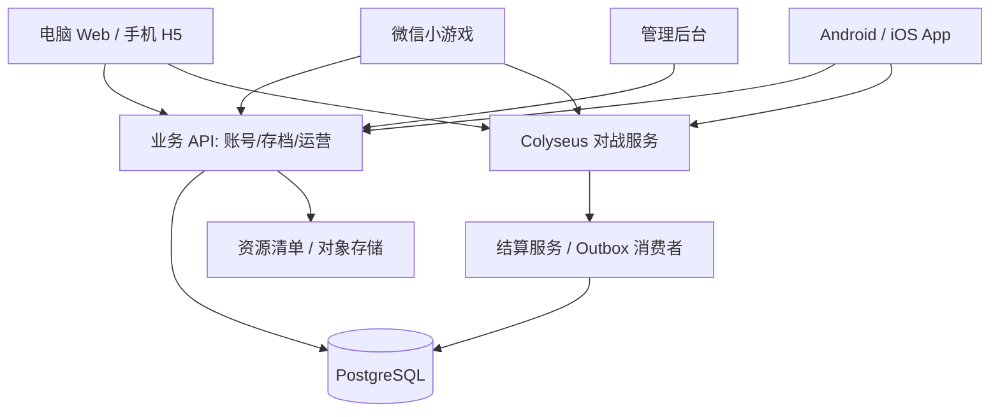

# 技术栈与架构规范

## 1. 已选方案

新增依赖的主版本是实施目标，不是已安装事实。FND-02 核实维护状态、许可证和与现有依赖的兼容性，锁定具体补丁版本及 npm 锁文件；不能直接安装未验证的 latest。若目标版本已停止维护，用 ADR 记录替代及验证，不默默更换框架。

| 层 | 默认选择 | 理由与边界 |
|---|---|---|
| 语言/运行时 | TypeScript strict；Node.js 24 LTS；npm + package-lock | 延续现有代码，CI/开发/生产统一版本 |
| 工程组织 | npm workspaces，逐步形成 apps/packages | 先保留现有命令和目录，用重导出过渡，禁止一次搬空 |
| 对战 | 现有 Colyseus 0.16、Planck 1.4.2 | 优先复用；升级在独立兼容任务完成，不能伴随 UI 改造隐式升级协议 |
| API | 现有 Express，按模块拆路由；Zod 4 作为边界 schema | 业务鉴权/API 与房间逻辑隔离；依赖漏洞按 FND-06 处理 |
| 数据库 | PostgreSQL 17；pg 驱动；版本化 SQL migration | 事务、唯一约束、锁与审计清晰；开发和测试使用同一数据库类型 |
| 查询/迁移 | 参数化 SQL + repository/service；node-pg-migrate | 避免拼接 SQL；迁移 up/down 或可验证的前向修复，生产不自动执行破坏性 down |
| 认证 | 自有 userId；邮箱+密码作为首个真实本地登录渠道；微信身份接入 | 密码使用 Argon2id 成熟库；邮箱验证/找回必须真实投递验收。短信登录是后续渠道，不强绑供应商 |
| 会话 | Web HttpOnly Cookie；App refresh token 安全存储；小游戏刷新凭证由服务端控制 | 短时 access token + 旋转 refresh；服务端可撤销，详见领域契约 |
| Web/H5 | React 19 + Vite + React Router 7 | 大厅和业务页面增量替换 DOM 拼接；比赛 Canvas 核心通过宿主桥接 |
| Web 状态 | TanStack Query 5 管服务端数据；Zustand 5 管轻量界面状态 | 余额/等级不能以本地 store 为权威；避免两套缓存互相覆盖 |
| 样式 | CSS Modules + CSS variables/design tokens | 平台统一颜色/间距/状态，各端独立布局；不要求 Canvas UI 复用 CSS |
| 管理后台 | React + Ant Design 6.7.1 候选 + 同一业务 API 的 admin 路由 | FND-02 核实发行/peer；UI 接入时实际验证，与游戏页面不同入口 |
| 微信小游戏 | TypeScript + 微信小游戏官方 API/适配层 + Canvas2D | 大厅/HUD 重做；保留规则/物理及数据模型。不能依赖 DOM、WebAudio、浏览器 Worker 的隐式存在 |
| Android/iOS | Capacitor 8.6.2 作为 PoC 候选；Android WebView / iOS WKWebView | FND-02 核实 Node 兼容；APP-01 验证原生系统/商店要求，性能通过才全面封装 |
| 电脑安装包 | 默认暂不制作 | WEB-06 根据实际需求决策；需要时在 Tauri 2/Electron 中选一个，不双实现 |
| 缓存/分布式 | 初期不依赖 Redis | PostgreSQL 保存权威业务；多进程队列/Colyseus presence 按容量证据引入 Redis 7 或受维护兼容版 |
| 资源 | 版本 manifest + 内容哈希；生产对象存储/CDN | 本地资源服务器同契约；供应商通过配置选择 |
| 日志/监控 | pino 结构化日志、OpenTelemetry、Prometheus/Grafana | 错误追踪可接 Sentry 兼容接口；供应商未配置不影响本地验证 |
| 测试 | 现有脚本保留；Vitest 新增业务测试；Playwright Web；k6 WebSocket/HTTP 压测 | 微信开发者工具与真机、Android/iOS 原生测试单独验收 |
| 发布 | Docker Compose 本地/单机；GitHub Actions；反向代理 Caddy | HTTPS/WSS、迁移、就绪与回滚；未有容量证据不引入 Kubernetes |

## 2. 目标边界



初期 API、房间和结算消费者可在一个 Node 进程中启动，但通过接口解耦。房间只提交服务端产生的结算命令，不能让客户端直接调用发奖。是否拆进程由 OPS-06 的延迟、CPU、恢复和容量证据决定。

### 推荐目录（目标，不要求首次任务全部创建）

```text
apps/web/                 React 大厅 + Canvas 对战宿主
apps/admin/               管理后台
apps/minigame-wechat/     微信工程与独立场景 UI
apps/mobile/              Capacitor 配置、原生平台插件
apps/server/              HTTP/Colyseus 启动、路由、装配
packages/game-core/      纯规则/物理/AI；当前 shared 的演进方向
packages/contracts/      DTO、schema、协议与错误码
packages/client-model/   跨端业务状态机、视图模型、资源选择
packages/platform/       平台接口；不在导入时访问全局对象
packages/ui-tokens/      颜色、字号、间距、语义状态与资源 ID
packages/server-domain/  账号、资产、结算、运营业务
packages/persistence/    SQL migrations/repository/outbox
config/                  非秘密配置 schema 与示例
docs/productization/     本实施规范
docs/adr/                有编号的决策及测量证据
tools/                   导入、验证、备份、压测与清单工具
```

ARC-01 每迁移一个模块就保留旧路径重导出或同步更新调用方；现有 `npm run build/typecheck/test` 必须持续可运行。大目录重排不与玩法变化混在一个提交。

## 3. 依赖规则

1. game-core 不允许依赖 React、Express、wx、window、document、localStorage 或数据库。
2. contracts 不导入 UI/服务端实现；schema 在客户端只用于解析，不代替服务端权限校验。
3. client-model 依赖 contracts 和平台接口，不依赖具体画布/DOM。用户资产来源只能是服务端响应。
4. UI 触发动作，状态机调用服务，适配器访问平台；渲染不能直接写数据库或决定奖励。
5. server-domain 依赖 repository 接口；事务边界由业务 service 拥有，不在多个 repository 内独立提交。
6. 静态定义与用户存档分离：playerDefId、ownedCardId、pieceId、userId、matchId 含义不同，禁止混用。

## 4. 必须建立的 ADR

| ADR | 默认结论 / 需验证内容 |
|---|---|
| 0001 平台范围 | 微信小游戏为可玩端；PC/H5/App 共用 Web 业务视图，小游戏重做宿主界面 |
| 0002 认证会话 | Web Cookie + 原生/小游戏 refresh；房间使用短时一次性票据 |
| 0003 对战公平 | 练习/约战可均衡等级；正式成长模式使用服务端持有卡；排位规则版本化 |
| 0004 持久化 | PostgreSQL 业务数据 + durable match outcome + 幂等结算；JSON 仅开发兼容 |
| 0005 客户端方案 | React Web + Canvas2D；微信纯 Canvas2D PoC；App Capacitor PoC |
| 0006 几何与资源 | 物理几何唯一来源；所有皮肤共享边界；美术不能改变碰撞 |
| 0007 运营发布 | 非付费先行；配置发布带校验、版本、灰度及回滚 |

需要调整时记录：问题、可选项、最终选择、测量环境/结果、迁移范围、回滚方式、影响任务。实际测量优先于框架偏好。

## 5. 接口约束代码提示

以下是契约草案，ARC-02/03 应补上具体实现、错误处理与契约测试。不能直接复制成空接口后勾选任务。

```ts
export type PlatformKind = 'web' | 'wechat-game' | 'android' | 'ios';
export interface PlatformServices {
  kind: PlatformKind;
  storage: {
    read(key: string): Promise<string | null>;
    write(key: string, value: string): Promise<void>;
    remove(key: string): Promise<void>;
  };
  // Web refresh 凭证不经 JS 读取；原生由 Keychain/Keystore 插件实现。
  credentials: {
    refreshSession(): Promise<{ accessToken: string; expiresAt: number }>;
    clearSession(): Promise<void>;
  };
  lifecycle: {
    onChange(fn: (state: 'active' | 'background') => void): () => void;
  };
  viewport: { read(): Viewport; subscribe(fn: (v: Viewport) => void): () => void };
  audio: { unlock(): Promise<void>; play(id: string): void; dispose(): void };
  network: NetworkAdapter;
}
export interface Viewport {
  width: number; height: number; pixelRatio: number;
  safeArea: { top: number; right: number; bottom: number; left: number };
  input: 'fine' | 'coarse';
}
```

NetworkAdapter 必须覆盖 HTTPS、WebSocket 建连/关闭/错误、取消、超时、二进制编码及消息大小上限。不能假设 colyseus.js 原生 browser fetch/WebSocket 可直接在微信使用。WX-02 通过真实 SDK 的建房、出手和恢复验证适配，而非只验证能打开 socket。

```ts
export interface MatchOutcomeSink {
  // 返回代表已持久化，不代表已广播/已发奖。
  record(outcome: AuthoritativeOutcome): Promise<'stored' | 'already-stored'>;
}
export interface GameHostBridge {
  mount(root: unknown, context: MatchContext): Promise<void>;
  resize(viewport: Viewport): void;
  suspend(): void;
  resume(): Promise<void>;
  dispose(): Promise<void>;
}
```

并发出手先做 per-room 串行处理。引入 worker 后，也要校验 matchId/turnId/configVersion，只有计算结果仍对应当前状态才提交；不能让 await 期间的超时/认输与旧计算结果互相覆盖。
